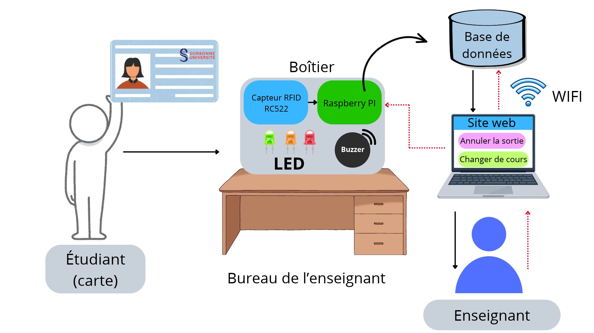

# Système de pointage RFID

## Introduction

L'idée du projet vient d'une observation lors des cours à l'université : la prise de présence manuelle prend du temps et peut provoquer des erreurs. 

Le projet a pour objectif de développer un système de pointage automatique : un boîtier posé sur le bureau de l'enseignant enregistre l'entrée et la sortie des étudiants de la classe lorsqu'ils passent leur carte RFID, et un site web permet à l'enseignant de consulter les présences en direct, de corriger une erreur d'enregistrement et de réinitialiser le boîtier pour le prochain cours.

## Schéma général du projet

Le dispositif sera composé :
* Capteur RFID (RC522)
* LED (Verte / Orange / Rouge)
* Raspberry Pi
* Buzzer

*Figure 1. Schéma général du système de pointage RFID.*

La figure 1 présente le dispositif. Le capteur RFID lit la carte de l'étudiant et transmet l'information au Raspberry Pi, qui enregistre la présence dans la base de données et signale le résultat par une LED de couleur (et un buzzer en cas de refus). Les présences sont consultables par l'enseignant sur le site web. Les flèches rouges en pointillés représentent les commandes de l'enseignant : depuis le site, il peut changer de cours (ce qui réinitialise le boîtier pour la prochaine séance) ou sélectionner la sortie d'un étudiant pour l'annuler directement dans la base de données en cas d'erreur.

## Scénarios d'usages

<ins>**Scénario 1 :**</ins> L'étudiant passe sa carte devant le capteur RFID du boîtier. Si la carte appartient à un étudiant inscrit au cours actuel, le Raspberry Pi enregistre l'heure dans la base de données et la LED verte s'allume : c'est l'entrée. Un délai minimum de 1 minute propre à chaque carte est imposé entre deux passages pour éviter les doubles badgeages. Une fois ce délai écoulé, un nouveau passage de la carte enregistre la sortie. Le système enregistre au maximum deux passages par séance (entrée et sortie).

<ins>**Scénario 2 :**</ins> Si l'étudiant repasse sa carte alors que son passage a déjà été pris en compte, c'est-à-dire avant la fin de son délai de 1 minute ou après l'enregistrement de son entrée et de sa sortie, la LED orange s'allume. Rien n'est enregistré.

<ins>**Scénario 3 :**</ins> Si la carte n'est pas reconnue ou n'appartient pas à un étudiant inscrit au cours, la LED rouge s'allume et le buzzer retentit. La présence n'est pas enregistrée.

<ins>**Scénario 4 :**</ins> L'enseignant se connecte au site web depuis son ordinateur et regarde en direct la liste des étudiants présents. S'il remarque qu'une sortie a été enregistrée par erreur, il clique sur « Annuler la sortie » à côté du nom de l'étudiant. L'heure de sortie est supprimée de la base de données et l'étudiant redevient présent.

<ins>**Scénario 5 :**</ins> L'enseignant souhaite passer à un autre cours. Il clique sur le bouton « Changer de cours » du site web, ce qui réinitialise le boîtier et le prépare à enregistrer les présences de la séance suivante.

## Description des fonctionnalités

| *N°* | *Nom* | *Description* | *Sur quoi la fonction agit* | *Importance* |
|:---: |:------ |:------------ |:-------------- |:------: |
| 1 | Lire la carte | Le capteur RFID lit l'identifiant de la carte de l'étudiant et le transmet au Raspberry Pi | Carte, capteur RFID, Raspberry Pi | 1 |
| 2 | Enregistrer le passage | Le Raspberry Pi vérifie que l'étudiant est inscrit au cours, puis enregistre son entrée ou sa sortie avec l'heure dans la base de données | Raspberry Pi, base de données | 1 |
| 3 | Signaler le résultat | La LED s'allume en vert, orange ou rouge selon le résultat de la lecture, et le buzzer retentit en cas de refus | Raspberry Pi, LED, buzzer | 1 |
| 4 | Afficher les présents | Lorsque l'enseignant consulte le site web, il peut voir la liste des étudiants présents à partir de la base de données | Enseignant, site web, base de données | 1 |
| 5 | Annuler la sortie | L'enseignant clique sur le bouton d'annulation à côté du nom de l'étudiant pour supprimer son heure de sortie dans la base de données | Enseignant, site web, base de données | 2 |
| 6 | Changer de cours | Quand le cours est terminé, l'enseignant peut réinitialiser le boîtier et initialiser une nouvelle séance dans la base de données | Enseignant, site web, Raspberry Pi, base de données | 2 |

## Planning prévisionnel

*To be continued ...*

